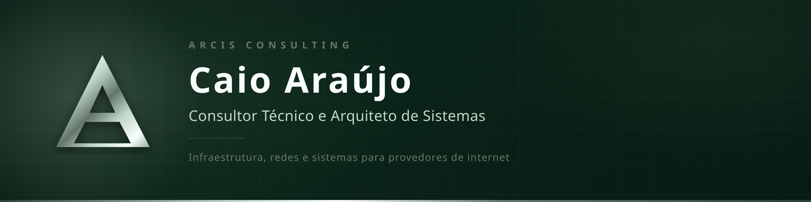
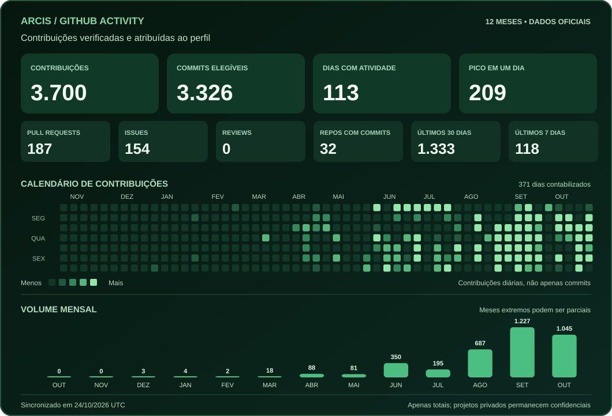

<h1 align="center">Caio Araújo</h1>

  <strong>Arquiteto de Sistemas · Especialista em Infraestrutura ISP · Fundador da Arcis Consulting</strong>

  
  
  

## Sobre mim

Trabalho na interseção entre **telecomunicações, infraestrutura, engenharia de software e dados**. Minha atuação começa na operação real de provedores de internet e avança até a arquitetura de soluções que conectam redes, sistemas de gestão, observabilidade e automação.

Sou fundador da **Arcis Consulting**, com foco em consultoria técnica para ISPs, estruturação de ambientes, integração de sistemas e padronização operacional. Também atuo em projetos de virtualização, monitoramento e desenvolvimento de aplicações para operações de telecomunicações.

Minha trajetória inclui campo, suporte de segundo nível (N2), NOC e responsabilidade técnica. Essa experiência orienta meu trabalho: **projetar soluções sustentáveis, observáveis e adequadas à realidade operacional**.

## Áreas de atuação

| Especialidade | O que desenvolvo e estruturo |
| :--- | :--- |
| **Arquitetura de Sistemas** | Desenho de serviços, APIs, integrações, modelagem de dados, evolução de sistemas e padrões de implementação |
| **Infraestrutura ISP / FTTH** | Redes GPON/EPON, roteamento, PPPoE, VLAN, CGNAT, equipamentos de acesso e borda |
| **Plataformas e Operação** | Linux, Proxmox VE, containers, serviços, disponibilidade e continuidade operacional |
| **Observabilidade / NOC** | Monitoramento, telemetria, alertas acionáveis, dashboards e investigação de incidentes |
| **Dados e Integrações** | Python, ETL, PostgreSQL, SGP TSMX, indicadores e automação de rotinas |
| **Automação e Agentes de IA** | Fluxos operacionais, integrações entre ferramentas, agentes assistivos e trilhas de auditoria |

## Soluções e frentes de engenharia

- **Plataformas para ISPs:** integração entre sistemas de gestão, serviços operacionais e bases de dados, reduzindo trabalho manual e inconsistências.
- **Centrais de monitoramento:** painéis para NOC, consolidação de alertas, visualização de infraestrutura e acompanhamento de disponibilidade.
- **Automação operacional:** ferramentas e serviços para coleta de dados, tarefas recorrentes, diagnósticos e apoio à tomada de decisão.
- **Aplicações e comunicação:** sistemas web, APIs e soluções de atendimento integradas às rotinas de provedores.

> Parte relevante do meu trabalho é desenvolvida em repositórios privados, por envolver sistemas corporativos, infraestrutura e projetos em execução. Os indicadores públicos de atividade são agregados e não expõem esses ambientes.

## Tecnologias

**Software, APIs e dados**

**Infraestrutura, redes e observabilidade**

## Atividade no GitHub

O painel abaixo utiliza a **API GraphQL oficial do GitHub** para apresentar minha atividade profissional e de desenvolvimento nos **últimos 12 meses**. Depois da primeira sincronização autenticada, os dados são atualizados automaticamente a cada seis horas.

**Indicadores:** contribuições totais, commits elegíveis atribuídos à minha conta, pull requests, issues, code reviews, repositórios com commits, dias ativos, atividade nos últimos 7/30 dias, calendário anual e volume por mês.

Os números vêm do calendário oficial de contribuições, não de uma amostra de commits por repositório. Atividades privadas podem ser incluídas com autorização, **sem publicar o nome nem o conteúdo dos projetos**. O painel preserva o último resultado válido em caso de falha. A configuração da primeira sincronização está descrita em [Ativar estatísticas privadas](./docs/PROFILE_STATS_SETUP.md). Veja também o [plano de implantação](./docs/GITHUB_PROFILE_ACTIVITY_PLAN.md).

<strong>Por que contribuições e commits têm números diferentes?</strong>

O calendário de contribuições contabiliza diferentes atividades elegíveis, incluindo commits, issues, pull requests e revisões. A contagem de commits segue as regras de autoria e elegibilidade do próprio GitHub; portanto, não equivale ao número bruto de commits encontrados em todos os repositórios.

## Trajetória

| Período | Atuação |
| :--- | :--- |
| **2026 — atual** | **Arcis Consulting** — consultoria de infraestrutura e arquitetura de sistemas para ISPs |
| **2025 — 2026** | **NOC e Suporte N2** — infraestrutura e operação FTTH |
| **2025** | **Responsabilidade técnica e sistemas** — estruturação de SGP e processos operacionais |
| **2021 — 2025** | **Helpdesk N2** — suporte e monitoramento de uma operação com cerca de 4.200 clientes |
| **2019 — 2021** | **Campo** — instalação e manutenção de redes FTTH, UTP e rádio |

## Formação

- **CST em Ciência de Dados — UNINTER** · conclusão prevista para outubro de 2028
- **Analista de Redes — Fórum Telecom** · 2024
- Formação complementar em desenvolvimento web, Python, Linux, infraestrutura e segurança da informação

## Contato

Paulista / Recife · Pernambuco · Brasil
